

  

<a href="#user-content-profile">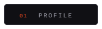</a><a href="#user-content-stack">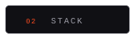</a><a href="#user-content-work">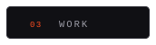</a><a href="#user-content-cp">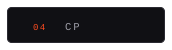</a><a href="#user-content-stats">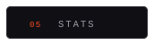</a><a href="#user-content-contact">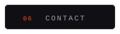</a>

 

I'm a software engineering student at **Daffodil International University (DIU)** in Dhaka, focused on building robust, scalable web applications and intelligent machine learning systems.

My technical focus bridges **modern full-stack web platforms**, **backend system architecture**, and **algorithmic problem solving**. When I'm not developing software products, I actively hone my analytical skills through competitive programming on **Codeforces**, **Toph**, and **Beecrowd**.

 

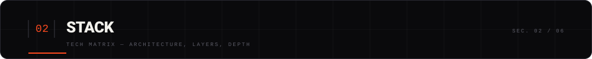

Five architectural layers, engineered for performance, precision, and scalability—spanning from low-level algorithms to high-level reactive interfaces and computer vision.

  

 

 

<a href="https://github.com/rhpiyas/Smart-Parking-System">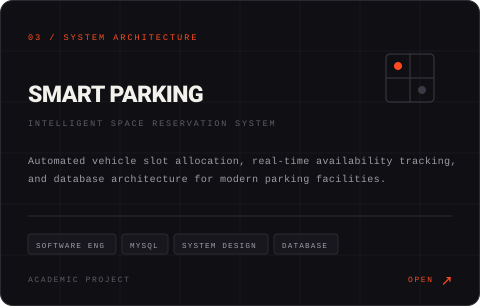</a> <a href="https://github.com/rhpiyas/Count-Me">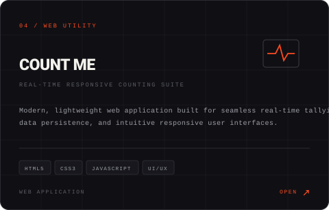</a>

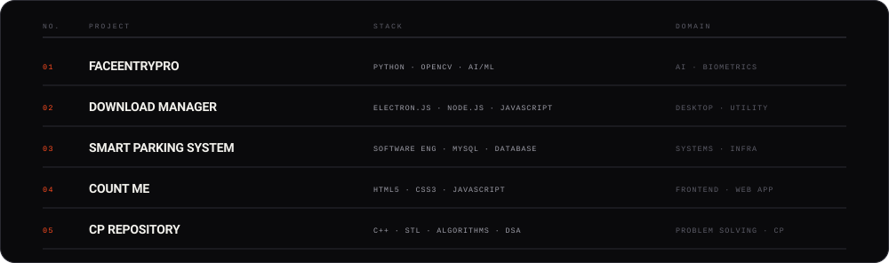

 

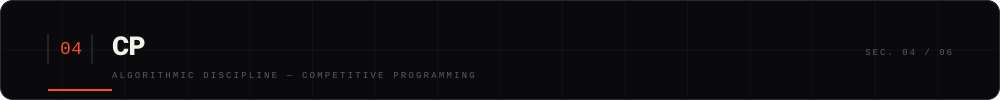

Algorithmic rigor forms the cornerstone of my software engineering discipline. Actively participating in programming contests and solving algorithmic problems across multiple platforms:

  
  &nbsp;&nbsp;
  
  &nbsp;&nbsp;
  
  &nbsp;&nbsp;
  

 

  
  &nbsp;
  

    

  

    

  

 

  

 

  

 

  Open to software engineering internships, research collaborations, and ambitious technical projects.

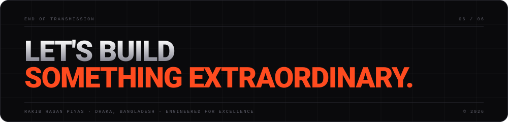
